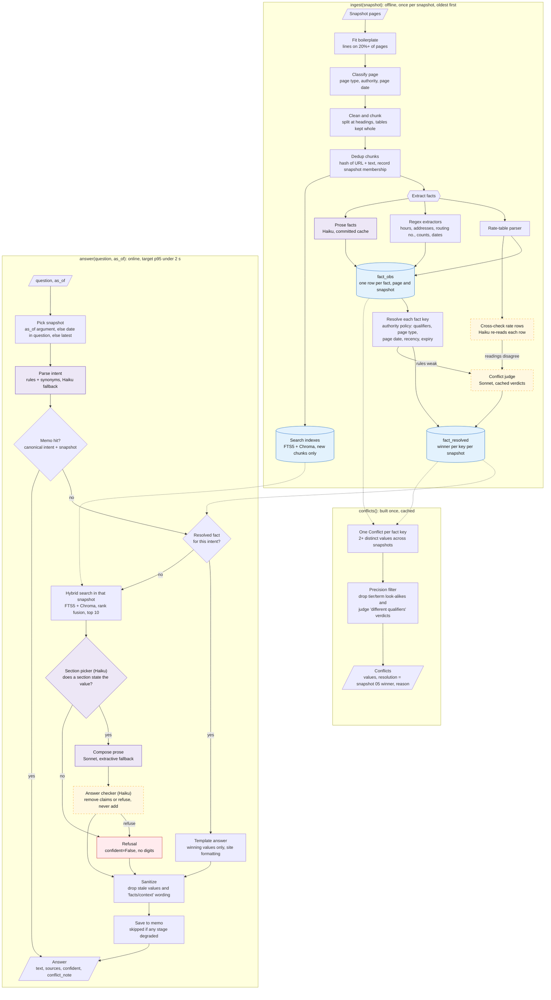

# A knowledge system that knows what's true now

This system answers questions about a credit union's website from five crawled snapshots. It gives the
current value, the right tier, a source, and an honest "isn't listed" when the site doesn't say.

- The solution is in **`submission/`** (`submission/solution.py` → `build()`).
- How it decides what is current, the API keys it needs, and the paid-API disclosure:
  **[`submission/NOTES.md`](submission/NOTES.md)**.

## Setup

Run every command from the repository root.

1. **Python 3.11 virtual environment**
   ```bash
   python3.11 -m venv .venv
   source .venv/bin/activate
   ```
2. **Install dependencies** (pinned versions)
   ```bash
   pip install -r submission/requirements.txt
   ```
3. **Snapshots.** The snapshot data is not in git. Put the five zips in `snapshots_zip/` at the repo
   root:
   ```
   snapshots_zip/01_2026-05-12_baseline.zip
   snapshots_zip/02_2026-05-19_recrawl.zip
   snapshots_zip/03_2026-06-09_recrawl.zip
   snapshots_zip/04_2026-08-27_rebaseline.zip
   snapshots_zip/05_2026-09-28_latest.zip
   ```
   You don't need to unzip them. On the first run, `harness/run_eval.py` unpacks them into
   `snapshots/` and skips any snapshot folder that already has a `manifest.json`.
4. **API key.** The system calls Claude (Haiku 5.5 and Sonnet 5.5) through the Anthropic API:
   ```bash
   export ANTHROPIC_API_KEY=...
   ```
   Without a key, or with `KB_NO_LLM=1`, the system runs in a rules-only fallback mode at lower
   accuracy. See `submission/NOTES.md`.
5. **LangSmith tracing (optional).** Set the variables in `.env.example` (`LANGSMITH_TRACING=true`,
   `LANGSMITH_API_KEY`, `LANGSMITH_PROJECT`, optional `KB_ENV`). Without them tracing is a no-op. Each
   `answer()` becomes a trace: intent parsing, fact selection, hybrid search, section picking, rendering, the
   stale-value guardrail, and every Claude call (via `wrap_anthropic`). Ingest is traced per snapshot and per
   page. Code is in `submission/kb/tracing.py`.

## Run

```bash
python harness/run_eval.py --submission submission --eval eval/public_eval.jsonl
```

- Add `--judge` to blend in the harness's LLM judge for free-text items. It also needs
  `ANTHROPIC_API_KEY`.
- Add `--conflicts-gold dev/conflicts_gold.json` to score `conflicts()` against our dev gold.
- Results go to `results/` (`report.json`, `per_question.jsonl`).

What to expect on the first run from a fresh clone:
- The harness unpacks the zips. Chroma downloads its ONNX embedding model (all-MiniLM-L6-v2, about
  80 MB) into `~/.cache/chroma/` if this machine doesn't have it yet.
- Ingest makes Claude Haiku calls for prose facts, capped at 300 s of LLM time per snapshot.
- Prose facts for the 231 in-scope chunks come from the committed `submission/data/facts_cache.jsonl`; only chunks missing from it call the API.
- In our last local scored run, ingest took 387.6 s. That figure is from a local run's `results/`
  report, which is not committed. A cold fresh clone has not been timed yet. The harness's 30-minute
  ingest limit is a hard cap.
- LLM responses are cached in `submission/.cache/llm.sqlite`. Every run rebuilds the fact store and the
  Chroma index in `submission/.cache/`, including re-embedding every chunk.
- Only the LLM cache persists between runs. Local runs that reused it took 376–456 s to ingest, well
  over the plan's "under 2 min warm" target.

Latest local scores (`dev/scores.csv`, public eval with `--judge`):
- QA 0.790 (the starter scores 0.093).
- Conflicts F1 0.784 on our dev gold.
- Final score 0.787, which includes the conflicts pillar scored against our dev gold. This is from a
  local run's `results/` report, which is not committed; `dev/scores.csv` has no final-score column.
- p95 latency 3.11 s.

## Repository layout

| Path | What |
|---|---|
| `submission/` | The solution: `solution.py`, `kb/` package, `requirements.txt`, `NOTES.md`, `data/facts_cache.jsonl` (committed LLM-extraction cache: 231 chunks, derived values only, built with `dev/build_facts_cache.py`). |
| `harness/`, `eval/`, `starter/` | The organizers' kit (unchanged). |
| `tests/` | Unit and integration tests (after setup, `pip install -r requirements-dev.txt`, then `pytest`). |
| `dev/` | Dev fixtures (paraphrase, as_of, refusal sets; conflicts gold), `score_run.sh`, `clean_env_check.sh`, `scores.csv`. |
| `snapshots/README.md` | The kit's description of what changed between snapshots (the snapshot data itself is git-ignored). |

## Checking a clean environment

`dev/clean_env_check.sh` follows the steps above in a temp dir:
1. a fresh `git clone`;
2. a new 3.11 venv and `pip install`;
3. copying the zips;
4. the eval with `--judge`, run cold and then warm.

It prints the ingest time, p95 and max latency for both runs. Two checks are expected to FAIL with the
current code:
- warm ingest under 120 s (see above);
- p95 of 1.5 s or less (currently 3.11 s). `dev/clean_env_check.sh --preflight`
runs only the cheap part: prerequisites, clone, zip copy and the harness's auto-unpack.

## Agentic workflow



### How to read the diagram
- **Purple:** steps that call an LLM. Every call goes through `kb/llm.py`, which caches results and returns `None` on failure. The step then falls back to its rule-based or extractive path instead of crashing.
- **Dashed amber:** the conflict judge, the rate-table cross-check and the answer checker. They are in `PROJECT_PLAN.md` (see `IMPROVEMENTS.md` §4.1–4.3) but not yet in the implementation plan or the code. The answer checker is kept only if it fixes more answers than it breaks.
- **Blue:** SQLite tables and search indexes, rebuilt at each run. Only the LLM caches (extracted facts and judge verdicts) are committed. Snapshot text never enters git.
- **Red:** the refusal. The scorer gives credit only if the answer has `confident=False` and adds no number that isn't in the question.
- **Dotted arrows:** reads from the stores built at ingest.
- **Refusal rule** (implementation plan, Task 1.3): refuse when no resolved fact matches the intent **and** the section picker finds no section that states the value. A retrieval score never triggers a refusal on its own.
- **Fail-soft:** every stage in `ingest` and `answer` catches its own errors and degrades. Degraded answers are not saved to the memo.
